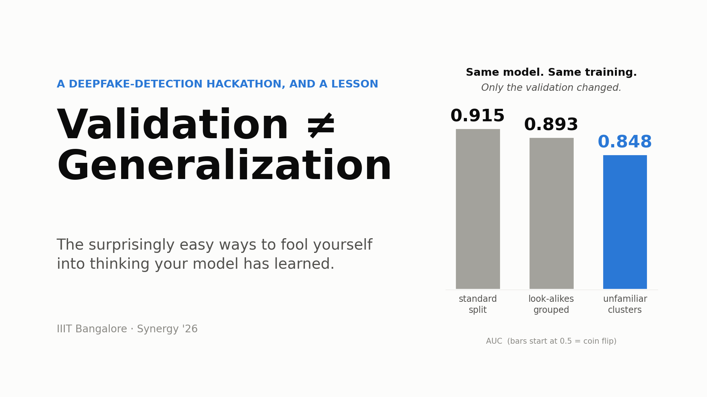
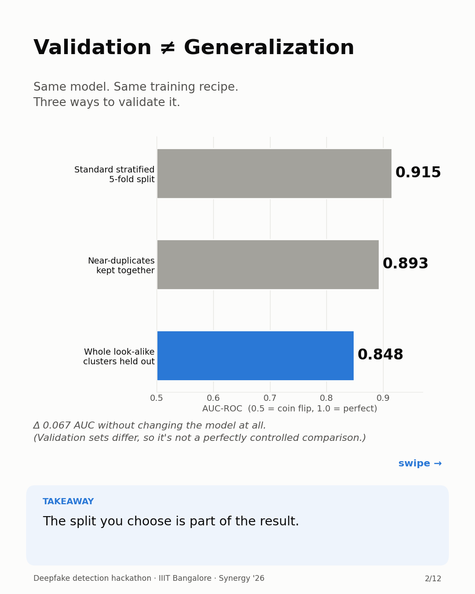
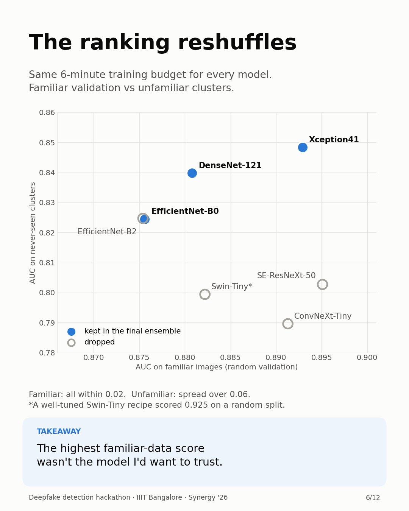
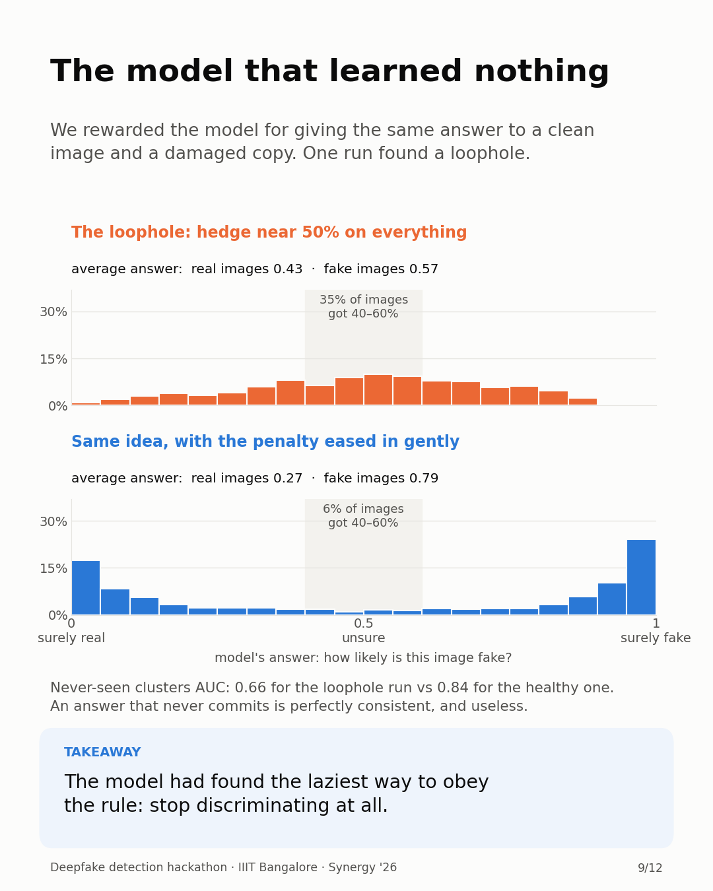

# iiit_synergy_2026_deepfake

**Deepfake face detection for the Deepfake ML Hackathon (Synergy '26), IIIT Bangalore**, built with an
automated research loop in the style of Karpathy's [AutoResearch](https://github.com/karpathy/autoresearch),
and an evaluation harness designed to stop us from fooling ourselves.



📝 **Write-up:** [Validation ≠ Generalization](docs/blog/validation-vs-generalization.md) ·
💼 **LinkedIn post + carousel:** [lnkd.in/p/dkxTBjYU](https://lnkd.in/p/dkxTBjYU) ·
📄 **Technical report:** [`docs/TECHNICAL_REPORT.pdf`](docs/TECHNICAL_REPORT.pdf)

**Team:** Dhruv Reddy Sambavaram, Sowmya Gupta

---

## Results at a glance

**Final model:** an average of 4 ImageNet-pretrained CNNs (Xception41 ×2, DenseNet-121, EfficientNet-B0) with
horizontal-flip test-time augmentation.

| Measured on an untouched holdout (589 images, never used for any decision) | |
|---|---|
| AUC-ROC | **0.908** (random images 0.919, held-out image clusters 0.893) |
| AUC under 7 corruption types never used in training | **0.899** |
| Accuracy / F1 at threshold 0.66 | 85.9% / 0.853 |
| Inference on an NVIDIA T4, 3,000 test images | **65.6 s**, 5.1 GB peak GPU memory, 0 label flips vs our machine |

The number we're proudest of isn't the AUC. It's that every number above was measured on data the search
never touched, after 55 experiments that were each judged on a validation set built to be hard to flatter.

---

## The idea: validation that can't flatter us

A model can score 0.915 AUC on a standard random split and **0.848** on genuinely unfamiliar images, with the same
recipe. So before training anything, we built a frozen evaluation harness that measures three things a random split
hides:

1. **Leakage.** 8.4% of a standard fold's validation images had a near-duplicate in training. We group
   look-alikes with a 64-bit difference hash (Hamming distance ≤ 6), and a group never crosses splits.
2. **Unfamiliar data.** ImageNet ResNet-50 features → k-means (16 clusters per class) → **whole clusters held out**,
   a stand-in for unseen generators and capture conditions.
3. **Robustness.** Every model is scored under **18 corruptions**. 11 are allowed as training augmentation; 7
   (WebP, motion blur, gamma, posterize, center-crop zoom, median filter, a downscale→JPEG "social media" chain)
   are **forbidden in training**, so they measure generalization rather than memorised augmentation.

All of this is rolled into one composite score:
`50·(2·AUC_main − 1) + 20·(2·AUC_robust − 1)`, where unseen corruptions weigh 60% of the robustness term.

---

## How we used AutoResearch

The search was run by an AI coding agent (Claude Code) inside a loop with hard guardrails, with humans steering
it at key points. The design follows Karpathy's AutoResearch: **freeze everything except one file, give the agent a
fixed compute budget per idea, and let the git history be the lab notebook.**

```
                ┌──────────────────────────────────────────────────────────────┐
                │ program.md: rules, research ladder, verdict policy           │
                └──────────────────────────────────────────────────────────────┘
                                             │
   read results.tsv + per-corruption AUCs → one hypothesis → edit train.py → git commit
                                             │
                     ./run_experiment.sh  (6-min training budget, then evaluate.py)
                                             │
     paired bootstrap vs current best (500 resamples) → KEEP / INCONCLUSIVE / DISCARD
                                             │
        KEEP: commit stays · INCONCLUSIVE (Δ ≥ 0.3): rerun with seed 1 · else: git revert
                                             │
                        log 1–3 lines in notes.md → next hypothesis
```

| Piece | Role |
|---|---|
| [`program.md`](program.md) | The agent's instructions: hard rules, the research ladder (lr → degradation augmentation → label noise → consistency training → backbones), verdict policy |
| `prepare.py`, `common.py`, `evaluate.py`, `run_experiment.sh` | **Frozen harness.** SHA-256 hashes in `data_splits/manifest.json`; `evaluate.py` refuses to run if any of them changed |
| [`train.py`](train.py) | The **only** file the agent may edit (model, augmentation, optimizer, loss) |
| [`results.tsv`](results.tsv) | One row per experiment: verdict, composite score, every AUC, size, speed, hypothesis |
| [`notes.md`](notes.md) | The research log: every hypothesis, result, mistake, correction and human decision |
| git history | Every hypothesis is a commit; failures are `git revert`s. Browse the commits to replay the search |

**Guardrails that mattered:**
- **A fixed 6-minute training budget** per experiment, so architectures compete on equal compute.
- **Decisions by paired bootstrap, not single scores.** A change is kept only if it beats the current best on at least
  450 of 500 resampled validation sets. Random seeds alone moved the score by about 1.5 points, so this rule
  prevented many false wins.
- **Banned augmentations.** The agent may never use the 7 held-out corruption types, or anything that imitates
  them. It once caught itself about to recreate the "social media" chain by stacking two allowed augmentations.
- **A three-use holdout budget.** The final 589 images were evaluated only twice in the whole project.

**Humans in the loop:** we redirected the agent several times. We paused the ladder for long-budget runs (they
showed we were *not* compute-limited), requested a head-to-head with a published Swin-Tiny recipe, fixed the
architecture pool, asked for seed ensembles, and stopped the loop. Every intervention is logged in `notes.md`.

**By the numbers:** 55 experiments (6 harness KEEPs, 5 inconclusive, 43 discarded), 7 backbones, about 8 minutes per
experiment, followed by greedy ensemble selection and a retrain of the chosen *configurations* on train+val at their
validated epoch counts.

---

## What we learned

The full story is in the [write-up](docs/blog/validation-vs-generalization.md) and the
[carousel](docs/linkedin/carousel_validation_vs_generalization.pdf). The short version:

| | |
|---|---|
|  | **The split is part of the result.** Same model and recipe: 0.915 on a standard split, 0.893 with look-alikes grouped, 0.848 on held-out clusters. |
|  | **The best familiar-data model wasn't the one to trust.** SE-ResNeXt-50 and ConvNeXt-Tiny were among the best on familiar validation and among the worst on unfamiliar clusters, so we dropped them. |
|  | **A model can game your rule.** With consistency training, one run learned to hedge near 50% on everything: perfectly consistent, and useless. Ramping the penalty in gently fixed it. |

More findings:
- **The biggest win was boring.** Raising EfficientNet-B0's learning rate from 3e-4 to 8e-3 lifted unfamiliar-cluster
  AUC from 0.72 to 0.82.
- **Longer training was worse.** Training 4–5× longer hurt every configuration we tried, because the short budget was
  acting as early stopping. The final retrain used the validated epoch counts.
- **Most augmentation tricks sat inside seed noise.** Random erasing, JPEG re-compression and mixup didn't earn their
  place. A blur/noise/downscale mix was positive on both seeds, and that configuration is in the final ensemble.
- **Our best single model was a lucky seed.** Three more seeds of the same config averaged 1.2 points lower, which is
  one reason the final model is an ensemble.
- **Explanations can fool you too.** Grad-CAM first suggested a border shortcut, but we were explaining the class the
  model had rejected. Explaining the predicted class put 83–89% of the attention on the face.

---

## Repository layout

```
prepare.py            FROZEN  leakage-free train/val/holdout splits (near-dup groups + held-out clusters)
common.py             FROZEN  image loading + the 18-corruption robustness suite
evaluate.py           FROZEN  scores a run: AUCs, guards, paired-bootstrap verdict, appends to results.tsv
run_experiment.sh     FROZEN  one experiment = train.py + evaluate.py
train.py              AGENT   the only file the research agent edits
program.md                    the agent's research instructions and rules
data_splits/                  frozen split CSVs (image IDs, labels, relative paths) + SHA-256 manifest
results.tsv, notes.md         the experiment table and the research log
holdout_log.tsv               the final holdout checks (2 of 3 allowed uses)
submission/                   inference_script.py, requirements.txt, predictions.csv
tools/                        final retrain, packing, ensemble selection, Grad-CAM, reproducibility checks
final/                        holdout metrics and the T4 timing report
colab_t4_check/               notebook used to verify speed and reproducibility on a Colab T4
docs/                         technical report, Grad-CAM, figures, blog post, LinkedIn carousel
```

Model weights (245 MB) and most per-run artifacts are not in the repo; they're rebuilt by the scripts below.
The exception is `runs/r0014`, `r0019`, `r0034`, `r0036`: the four configurations in the final ensemble (train.py
snapshot, training log, metrics, validation predictions), which the final retrain and threshold selection need.

---

## Reproduce

```bash
# 0. environment (Python 3.10)
pip install -r submission/requirements.txt scikit-learn matplotlib

# 1. data: put the hackathon dataset at ./hackathon_dataset (train/real, train/fake, train_metadata.csv).
#    The frozen split CSVs reference images relative to the repo root.
ln -s /path/to/hackathon_dataset hackathon_dataset

# 2. one experiment (what the agent ran 55 times)
./run_experiment.sh "hypothesis text" [epochs] [seed]

# 3. final members on train+val at their validated epoch counts, then pack the submission
./tools/final_retrain.sh
python tools/pack_submission.py --runs runs_final/xception_s0 runs_final/xception_s1 runs_final/densenet121 runs_final/b0_degrade \
       --tta --threshold_from runs/r0019 runs/r0034 runs/r0036 runs/r0014 --out submission/model_weights.pt

# 4. predict
python submission/inference_script.py --test_dir /path/to/test/images --weights submission/model_weights.pt --output predictions.csv
```
Set `PY=/path/to/python` for the shell scripts if `python` isn't the right interpreter. `prepare.py --data_dir …`
regenerates the splits from scratch, but it writes absolute paths and new hashes, so only do that if you want new
splits.

**Rules we followed:** only the provided data; ImageNet-pretrained weights only; test images were used only to produce
predictions (never trained on, selected on, or viewed).

**Credits:** the AutoResearch pattern by A. Karpathy. Ideas from the DFDC 2020 solutions (Seferbekov, NTechLab),
DeepFakeDefenders 2024 (cluster-based splits) and EDD 2026 (consistency training).
