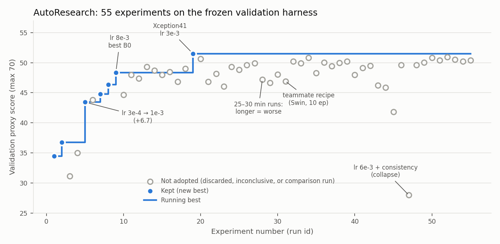
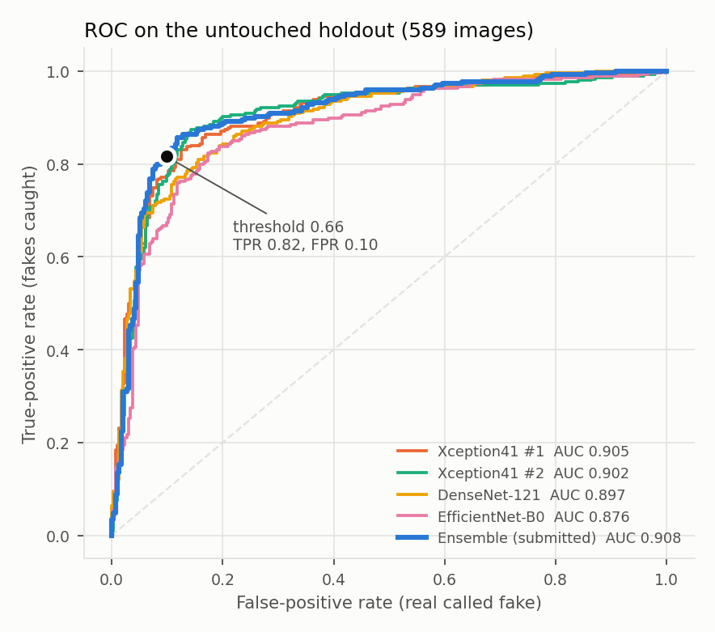
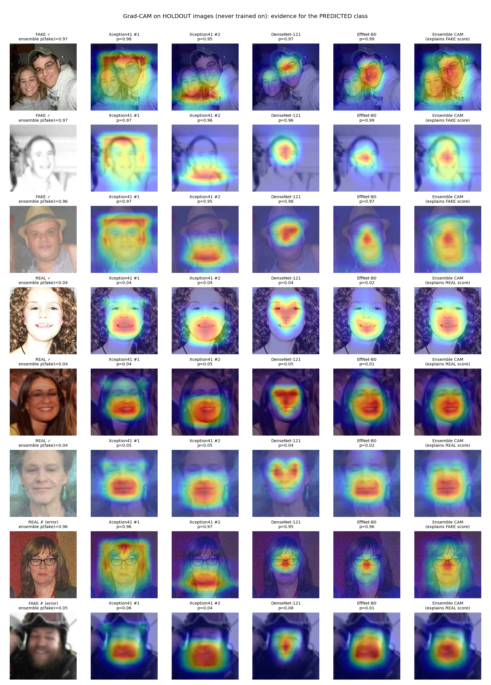
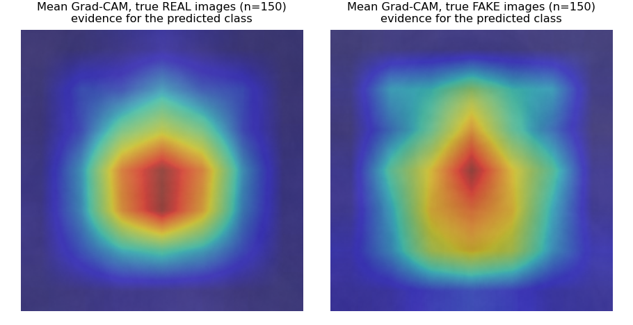

# Robust Deepfake Face Detection with an Automated, Leakage-Free Research Loop

**Deepfake ML Hackathon (Synergy '26), IIIT Bangalore**<br>
**Team members:** Dhruv Reddy Sambavaram, Sowmya Gupta · **Date:** 14 November 2026<br>
**Code:** `deepfake-autoresearch/` (source zip / GitHub link in the submission folder)

---

## Summary

We built a deepfake detector for 224×224 aligned face images. It is optimized for what this competition rewards:
AUC-ROC on a test set that, by the README, *"is designed to test generalization across different deepfake generation
methods"*, plus 20 points of robustness across undisclosed image variants.

Rather than hand-tuning one model, we:

1. froze an evaluation harness that cannot be gamed (a leakage-free split, held-out image clusters, an 18-corruption
   robustness suite, and a statistical keep/discard rule);
2. let an autonomous agent run **55 experiments** against it, following Karpathy's *AutoResearch* pattern;
3. selected and retrained a **4-model ensemble** (Xception41 ×2, DenseNet-121, EfficientNet-B0, with horizontal-flip
   TTA), and confirmed it on an **untouched holdout** (checked twice: before and after the final retrain).

| Final submission (holdout: 589 images never used for any decision) | Value |
|---|---|
| **AUC-ROC (clean)** | **0.908** (validation: 0.870) |
| AUC on held-out image clusters / on random images | 0.893 / 0.919 |
| Mean AUC under 7 corruptions never seen in training | 0.899 |
| **F1** / accuracy at the submitted threshold | **0.853** / 85.9% (validation: 0.837 / 83.2%) |
| Threshold | **0.660**, selected on validation by Youden's J (TPR − FPR) |
| Inference, 3,000 test images, NVIDIA T4 (Colab) | **65.6 s**, 5.1 GB peak GPU memory |
| Reproducibility (T4 vs our machine) | 0 label flips, max confidence difference 0.002 |

---

## 1. Problem statement and approach rationale

The task is binary classification, real (0) vs fake (1), scored by AUC-ROC on 3,000 private test images. Four
properties of the problem shaped every decision:

1. **There is no leaderboard.** Our own validation is the only feedback we get, so it must not flatter us. A random
   80/20 split leaks here (Section 3), and repeated selection on one val set overfits it. We designed against both.
2. **Generalization is what's tested.** The README warns that a model learning one generator's surface artifacts
   "may underperform". So we measure performance on *kinds of image the model has never seen*, not only on random
   val images.
3. **Robustness is worth 20 points and is the first tiebreaker.** We score every candidate under 18 corruptions. Seven
   of them are forbidden as training augmentation, so they measure real robustness, not memorized augmentation.
4. **The data is small** (7,000 labelled images). That favors pretrained CNNs, short training, and ensembles over
   large or custom architectures. Our experiments confirmed this (Section 6.4).

**Why an automated research loop.** With a frozen, trustworthy harness, many small controlled experiments beat a few
large guesses. Following Karpathy's AutoResearch, an agent edits a single file (`train.py`), trains for a **fixed
6-minute budget** (so models are compared at equal compute), is scored by the frozen harness, and keeps or reverts the
change in git. A paired bootstrap decides "keep", which guards against lucky noise. Every attempt is logged in
`results.tsv` and `notes.md`, which is the evidence base for Section 6.

---

## 2. Data analysis

| Property | Finding | Consequence |
|---|---|---|
| Size / balance | 3,478 real, 3,522 fake (49.7 / 50.3%); test 3,000 | No class weighting needed |
| Encoding | Every image is 224×224 RGB JPEG with an **identical quantization table** and identical metadata | No file-level shortcut; the model must learn image content |
| Organizer degradations | **Both** classes contain gray/black/white occlusion boxes, speckle noise, pixelation, grayscale, colour casts, low contrast, blur | "Degraded" ≠ "fake"; the hidden variants probably look like these |
| Near-duplicates | 356 links (perceptual hash), incl. **real/fake pairs made from the same source photo** | A random split leaks (Section 3) |
| Global sharpness | Laplacian variance (all 7,000 images): real mean 864 / median 176, fake mean 856 / median 147. Sharpness alone gives AUC **0.48** | No global-sharpness shortcut; the model must use local facial content |
| File size | Test files are smaller on average (12.4 KB vs 13.9 KB train) | Possible distribution shift, consistent with "different generation methods" |

Test images were used **only to generate predictions**. They were never trained on, never used for selection, and
never viewed. Agent permissions also block reading the test folder.

---

## 3. Validation design (frozen before any experiment)

### 3.1 Leakage-free split with held-out clusters (`prepare.py`)

1. **Near-duplicate grouping.** Each image gets a 64-bit dHash: a 9×8 grayscale thumbnail, one bit per neighbouring
   pixel pair. Images within Hamming distance ≤ 6 are linked, giving 7,000 images in **6,644 groups** (326 groups of
   2–5). A group never straddles two splits.
2. **Look-alike clusters.** Images are embedded with an ImageNet ResNet-50 (2,048-d, L2-normalized) and clustered with
   **K-means, 16 clusters per class**. Clustering per class guarantees both labels in every held-out set.
3. **Held-out clusters.** Whole clusters are removed at random from the mid-sized ones (3–9% of the images in that class): 2 real +
   2 fake clusters to **val-ood** (918 images), and 1 + 1 to **holdout-ood** (309).
4. **Random part.** The remaining groups are split at random into val-iid (561), holdout-iid (280) and **train
   (4,932)**.

| Split | Images | iid | ood (held-out clusters) | Role |
|---|---|---|---|---|
| train | 4,932 | 4,932 | 0 | training in the research loop |
| val | 1,479 | 561 | 918 | every experiment decision |
| holdout | 589 | 280 | 309 | final confirmation only (2 of 3 allowed uses spent) |

**Why not a plain random split?** We measured it: in a standard StratifiedKFold(5) split, **8.4% of the validation
fold's images have a near-duplicate in the training folds**. For reference, our Xception recipe scores 0.915 AUC on
such a fold versus 0.893 on our random-but-grouped val and 0.848 on our held-out clusters, so a random split
overstates generalization.

The held-out clusters stand in for unseen generators (the data carries no generator labels). This idea is borrowed
from the DeepFakeDefenders 2024 cluster-based hard splits.

### 3.2 Corruption suite (`common.py`)
Each val image is scored in 19 versions. All corruptions are deterministic (a fixed seed per image).

| Seen (11): may be used as augmentation | Unseen (7): forbidden in training |
|---|---|
| JPEG q50, q30 · Gaussian blur r1, r2 · Gaussian noise σ 2%, 5% · down-up ×0.5 · brightness ×1.25 / contrast ×0.75 · occlusion box (15–25%, gray/black/white) · pixelate ×0.25 · grayscale | WebP q30 · motion blur 9 px · gamma 1.5 · posterize 4-bit · center-crop 85% + zoom · median 3×3 · "re-share" (downscale 75% → JPEG 60 → upscale) |

### 3.3 Objective and decision rule (`evaluate.py`)
```
auc_main = ½·AUC(iid) + ½·AUC(ood)
auc_rob  = 0.4·mean AUC(seen) + 0.6·mean AUC(unseen)
proxy    = 50·(2·auc_main − 1) + 20·(2·auc_rob − 1)    # max 70 = 50 AUC + 20 robustness pts
```

- **Paired bootstrap:** 500 resamples of val, scoring the candidate and the current best on the same resamples.
  **KEEP** if the proxy improves and p(better) ≥ 0.90. INCONCLUSIVE runs are retried with another seed.
- **Guards:** ≤ 150 M parameters, ≤ 600 MB checkpoint, ≥ 100 img/s inference.
- **Tamper-proofing:** the harness files and splits are SHA-256 hash-checked on every run, and the agent may edit
  only `train.py`.

---

## 4. Model architecture

```
             224×224 RGB face (ImageNet-normalized)   +   its horizontal mirror
                                   │
     ┌──────────────┬──────────────┼──────────────┬
     ▼              ▼              ▼              ▼
 Xception41 #1  Xception41 #2  DenseNet-121   EfficientNet-B0
 (24.9 M)       (24.9 M)       (7.0 M)        (4.0 M)
 each: timm ImageNet-1k backbone → global-avg-pool → dropout 0.2 → linear → 1 logit
     │              │              │              │
  sigmoid, mean over {image, mirror}  for each model
     └──────────────┴──────┬───────┴──────────────┘
                           ▼
          mean of 4 probabilities = confidence = P(fake)
                           ▼
          label = confidence ≥ 0.660   (Youden's J on validation)
```

| Member | timm weights | Why it's in |
|---|---|---|
| Xception41 ×2 seeds | `xception41.tf_in1k` | Best single model (proxy 51.5, best held-out-cluster AUC among single CNNs); two seeds reduce seed variance |
| DenseNet-121 | `densenet121.ra_in1k` | Best ensemble partner: highest holdout ood AUC of any single model (0.889) and best worst-case robustness |
| EfficientNet-B0 | `efficientnet_b0.ra_in1k` | Fast, and trained with degradation augmentation, so it adds different errors |

The architecture is diverse (depthwise-separable, densely connected, and compound-scaled CNNs), the ensemble is a
plain probability average, and the total size is 245 MB. All weights are ImageNet-pretrained, as the rules permit; no
deepfake-pretrained weights or external data were used.

---

## 5. Training pipeline

| Item | Setting |
|---|---|
| Data loading | Raw JPEG bytes held in RAM; decoded per batch; 6 loader workers |
| Augmentation (all members) | Random horizontal flip (p = 0.5); RandomResizedCrop scale 0.85–1.0, aspect 0.95–1.05 (every view) |
| Extra augmentation (B0 only) | **Degrade aug**, p = 0.4: one of Gaussian blur (r 0.5–2), Gaussian noise (σ 1–5%), down-up-scale (0.4–0.9, bilinear), pixelate (0.2–0.5, nearest). Seen types only |
| Loss | Binary cross-entropy on a single logit |
| Optimizer | AdamW, weight decay 0.05, batch 64 |
| Learning rate | Xception / DenseNet **3e-3**, B0 **8e-3**; 0.5-epoch linear warmup, cosine decay to 0 |
| Training length | Loop: fixed 6-min wall clock. **Final retrain: fixed epochs** (Xception 4, DenseNet 5, B0 8), matching the validated runs |
| Final data | train + val (6,411 images); holdout never trained on |
| Hardware | Apple M4 Pro (MPS, fp32). Inference verified on an NVIDIA T4 (CUDA, fp16 autocast) |

On that machine, the channels-last memory layout made MPS training 2.4× slower, and bf16 gave no speed-up, so we
trained in fp32 with the default layout.

**Augmentation volume.** Augmentation is applied on the fly, with no stored copies. In the final retrain:

- each Xception sees 25,600 augmented views (4 × 6,400);
- DenseNet sees 32,000;
- B0 sees 51,200, of which about 20,500 are degraded.

---

## 6. Experiments and hyperparameter justification



*Figure 1. 55 experiments on the frozen harness. Blue = kept (new best); gray = not adopted. Most gray points after
run 19 are ensemble-candidate or diagnostic runs, judged by the contribution each makes to the ensemble, not as replacements.*

### 6.1 Learning rate: the main lever
EfficientNet-B0, 6-minute budget:

| lr | 1e-4 | 3e-4 (baseline) | 1e-3 | 2e-3 | 4e-3 | **8e-3** | 1.2e-2 |
|---|---|---|---|---|---|---|---|
| proxy | 31.2 | 36.8 | 43.4 | 44.8 | 46.4 | **48.4** | 44.7 |
| held-out-cluster AUC | 0.684 | 0.717 | 0.762 | 0.778 | 0.803 | **0.825** | 0.796 |

The baseline overfit badly: training AUC 0.99 against val AUC 0.74, final training loss 0.03. A higher learning rate
acted as a regularizer (final loss 0.39 at 8e-3), raised held-out-cluster AUC by 0.11, and fixed the collapse on
pixelated images (AUC 0.52 → 0.80). Each backbone then got its own sweep (Xception: 1e-3 → 49.0, **3e-3 → 51.5**,
6e-3 → 50.6; DenseNet: 1e-3 → 48.3, **3e-3 → 50.0**).

### 6.2 Backbones (each with its own lr sweep; best lr shown)

| Backbone | proxy | iid AUC | ood AUC | Decision |
|---|---|---|---|---|
| EfficientNet-B0 | 48.4 | 0.876 | 0.825 | kept (ensemble) |
| EfficientNet-B2 | 48.4 | 0.875 | 0.825 | no gain over B0 |
| **Xception41** | **51.5** | 0.893 | **0.848** | **kept (best single)** |
| DenseNet-121 | 50.0 | 0.881 | 0.840 | kept (best ensemble partner) |
| SE-ResNeXt50 | 48.2 | 0.895 | 0.803 | dropped: high iid, weak ood |
| ConvNeXt-Tiny (in22k→1k) | 46.8 | 0.891 | 0.790 | dropped: high iid, weak ood, hurt ensembles |
| Swin-Tiny (10 ep, lr 1.5e-4, MLP head) | 46.9 | 0.882 | 0.799 | dropped: weak ood, no ensemble gain |

The pattern is consistent: **high random-split AUC does not imply generalization.** Several models with the best iid
AUC were the worst on held-out clusters.

### 6.3 Augmentation and regularization (one change at a time, B0 base)

| Idea (inspiration) | Δ proxy | Outcome |
|---|---|---|
| Cutout / random erasing (DFDC winners) | −1.7 / −0.4 | rejected (ood fell) |
| Random JPEG quality 30–95 (DFDC 3rd/5th) | −1.0 | rejected |
| **Degrade aug: blur / noise / down-up / pixelate** | **+0.96 / +0.35** (2 seeds) | **adopted (B0 member)** |
| Clean-vs-degraded consistency loss (EDD 2026) | +0.5 to +1.0 | small; heavier variants hurt; not in final |
| Label smoothing 0.1 · mixup 0.2 · dropout 0.1 · weight decay 0.1 | within ±1 | noise-level; not adopted |
| Dropout 0.4 | −7 to −9 | rejected |

### 6.4 Longer training makes things worse (compute is not the bottleneck)

| Config | 6 min | 25–30 min | Δ |
|---|---|---|---|
| Xception41 | 4 epochs, 51.5 | 16 epochs, 47.2 | −4.3 |
| B0 + consistency | 5 epochs, 49.3 | 18 epochs, 46.6 | −2.7 |
| B0 + consistency + degrade aug | 49.3 | 19 epochs, 48.0 | −1.3 |

With about 5k images, short training works as early stopping. Augmentation reduces the damage of long training but
doesn't reverse it. **This is why the final retrain uses the validated epoch counts, not "train longer".**

### 6.5 Ensemble selection
Greedy forward selection on val (mean of probabilities, at most one model per run):

| Ensemble | proxy |
|---|---|
| Xception41 | 51.49 |
| + DenseNet-121 | 51.95 |
| + B0 degrade aug | 52.08 |
| + Xception41 (2nd seed) | 52.21 |
| + 5th model | 52.22 (noise → stop) |

Seed reruns showed the best single Xception run was about 1.2 points seed-lucky (seeds 2–4 average 50.3). We
therefore retrained **configurations**, not specific checkpoints.

---

## 7. Results: AUC-ROC, F1 and threshold selection

All metrics are computed with scikit-learn exactly as in the organizers' sample scoring code
(`roc_auc_score(true, confidence)`, `f1_score(true, label)`, `accuracy_score(true, label)`), by
`tools/report_metrics.py`, which also writes `docs/metrics_summary.json`.

- **Validation** (1,479 images): the four ensemble members trained on train only, no TTA. This is where every
  decision, including the threshold, was made.
- **Holdout** (589 images, never used for any decision): the **submitted** model, i.e. the members retrained on
  train+val, with flip TTA, exactly as `inference_script.py` predicts.

### 7.1 Headline metrics (submitted threshold 0.660)

| Metric | Validation (1,479) | **Holdout (589)** |
|---|---|---|
| **AUC-ROC** | 0.870 | **0.908** |
| **F1** | 0.837 | **0.853** |
| Accuracy | 83.2% | **85.9%** |
| Precision (fake) | 0.844 | 0.892 |
| Recall (fake) | 0.829 | 0.816 |
| Confusion matrix TN / FP / FN / TP | 593 / 118 / 131 / 637 | 266 / 29 / 54 / 240 |



*Figure 2. ROC curves on the untouched holdout for each member and the submitted ensemble; the dot marks the
submitted threshold (0.660): TPR 0.82 at FPR 0.10.*

### 7.2 By subset: familiar images vs never-seen clusters

| Subset | Val AUC | Val F1 | **Holdout AUC** | **Holdout F1** | Holdout accuracy |
|---|---|---|---|---|---|
| Random images (iid) | 0.898 | 0.852 | **0.919** | **0.882** | 88.2% |
| Held-out clusters (ood) | 0.853 | 0.827 | **0.893** | **0.824** | 83.8% |
| All | 0.870 | 0.837 | **0.908** | **0.853** | 85.9% |

The validation set is 62% held-out-cluster images, which is why its overall AUC sits below the holdout's (53%).

### 7.3 Per model (threshold 0.660)

| Model | Val AUC | Val F1 | Holdout AUC | Holdout F1 | Holdout accuracy |
|---|---|---|---|---|---|
| Xception41 #1 | 0.865 | 0.832 | 0.905 | 0.841 | 84.0% |
| Xception41 #2 | 0.862 | 0.832 | 0.902 | 0.846 | 85.1% |
| DenseNet-121 | 0.855 | 0.811 | 0.897 | 0.812 | 82.2% |
| EfficientNet-B0 | 0.843 | 0.799 | 0.876 | 0.804 | 81.3% |
| **Ensemble (submitted)** | **0.870** | **0.837** | **0.908** | **0.853** | **85.9%** |

The ensemble beats every member on AUC and F1 in both sets.

### 7.4 Threshold selection
AUC is threshold-free, so the threshold affects only the `label` column of `predictions.csv` (and hence accuracy and
F1), never the 50-point AUC score.

- **Method:** on validation, we chose the threshold that maximizes **Youden's J = TPR − FPR**, the standard choice for
  balanced classes (50.3% fake). Result: **0.660**, stored in `model_weights.pt` and applied by the inference script.
- **Alternatives considered on validation:**

| Threshold | Val F1 | Val accuracy | Val precision / recall | Val false positives |
|---|---|---|---|---|
| 0.500 (default) | 0.836 | 82.3% | 0.806 / 0.867 | 160 |
| 0.525 (max-F1) | 0.837 | 82.5% | 0.810 / 0.866 | 156 |
| **0.660 (Youden's J, submitted)** | **0.837** | **83.2%** | **0.844 / 0.829** | **118** |

- **Why 0.660:** F1 is essentially flat across these thresholds (0.836–0.837). Youden's J gives the highest
  accuracy and **26% fewer false alarms** (real faces wrongly flagged as fake). On the holdout it reproduces:
  accuracy 85.9% vs 85.7% at 0.5, F1 0.853 vs 0.858, false positives 29 vs 44.

### 7.5 Robustness, and the effect of the final retrain (holdout)

| | Train-only ensemble (holdout use 1) | **Retrained on train+val (use 2, submitted)** |
|---|---|---|
| AUC-ROC | 0.904 | **0.908** |
| iid / ood AUC | 0.923 / 0.881 | 0.919 / **0.893** |
| Seen / unseen corruption AUC | 0.898 / 0.893 | **0.905 / 0.899** |
| Worst corruption | 0.844 | **0.862** (crop-zoom) |
| Accuracy at threshold | 84.7% | **85.9%** |

Per-corruption holdout AUC of the submitted model:

- every corruption is **≥ 0.890**, except center-crop zoom (0.862);
- JPEG q50/q30 0.906/0.905, blur 0.910/0.909, noise 0.912/0.909, WebP 0.900, re-share 0.908, grayscale 0.904,
  occlusion box 0.896, pixelate 0.890.

The holdout came out slightly *above* validation. That suggests the 55-run selection process did not overfit
validation, though the holdout's single held-out cluster per class may simply be easier.

---

## 8. Explainability (Grad-CAM)



*Figure 3. Grad-CAM on holdout images for each member and for the ensemble, explaining the predicted class. Rows 1–3
are confident fakes, rows 4–6 confident reals, then the worst false positive and the worst false negative.*



*Figure 4. Mean Grad-CAM over 150 holdout reals and 150 holdout fakes (the faces are pre-aligned).*

- **Decisions rest on the face, not the background.** 83–89% of attention falls in the central face region, and only
  2–6% on the bottom edge.
- **Fake evidence spreads across eyes, nose/cheeks, mouth and the forehead boundary**, consistent with face-swap
  blending. Real evidence centres on the mouth and lower face.
- **Members attend to different regions**: Xception #1 the face boundary, Xception #2 the mouth and chin, DenseNet the
  eyes, B0 a tight centre. This complementary attention explains the ensemble gain.
- **Shortcut check:** explaining the *fake* score on real images showed weak bottom-edge evidence. Explaining the
  predicted class removed it, so it was an artifact of the explanation target, not a border shortcut.

---

## 9. Efficiency

| Measurement (3,000 test images, full ensemble, flip TTA) | Value |
|---|---|
| NVIDIA T4, cold run (judge conditions) | **65.6 s** (efficiency band < 5 min → full marks) |
| NVIDIA T4, warm run | 57.3 s |
| Peak GPU memory | 5.1 GB of 16 GB |
| Model file | 245 MB (limit 5 GB) |
| Apple M4 Pro (MPS) | 140 s |

The inference script batches images (128), decodes them in parallel workers, normalizes on the GPU, uses fp16
autocast on CUDA, and loads every model once.

---

## 10. Challenges and honest limitations

- **The held-out clusters are a stand-in for new generators.** They are visual look-alike groups, not real generator
  labels. A truly new generator may differ in other ways.
- **The corruption suite is our guess** at the undisclosed test variants. The submitted model's weakest case is
  center-crop zoom (0.862), so differently framed faces are a risk.
- **Small evaluation sets.** Holdout AUC carries about ±0.015 of noise, and seed variance is about ±1 proxy point. We
  retrained configurations and used bootstrap tests to avoid chasing noise, and we report the seed-luck we found.
- **Selection pressure on val.** 55 experiments on one val set causes some winner's curse. The untouched holdout gives
  the honest number.
- **Mistakes we corrected along the way:**
  - The initial hypothesis that the learning rate was too high was wrong; it was far too low.
  - "We are compute-limited" was also wrong (Section 6.4).
  - A first Grad-CAM pass was misleading until we explained the predicted class.
- **We traded a little familiar-data AUC for robustness.** Some rejected backbones (SE-ResNeXt50, ConvNeXt-Tiny) had
  slightly higher random-split AUC than our members but much weaker held-out-cluster AUC. If the test turns out to
  resemble a random split of the training distribution, a different selection might have scored marginally higher.
  We chose robustness, because the README and rubric weight it.
- **Errors concentrate on heavily degraded images:** strong noise with colour casts on real photos, and heavy blur on
  fakes (Figure 3).
- **Environment:** training ran on Apple MPS and inference was verified on CUDA. The two give 0 label flips and a
  maximum confidence difference of 0.002.

---

## 11. Reproducibility

**Environment:** Python 3.10, `torch==2.14.1`, `torchvision==0.29.2`, `timm==1.0.31`, `numpy==2.2.6`,
`pandas==2.3.3`, `pillow==12.3.0` (see `requirements.txt`). Verified on a Colab T4 (Python 3.13, CUDA build of the
same torch).

**Inference (what the judges run):**
```
pip install -r requirements.txt
python inference_script.py --test_dir ./test/images/ --weights ./model_weights.pt --output predictions.csv
```
The script picks CUDA (fp16) → Apple MPS → CPU automatically, has no hardcoded paths, and validates the output
format. Re-running it reproduces the submitted `predictions.csv` (0 label flips on a T4).

**Retraining from scratch:**
```
python prepare.py --data_dir <hackathon_dataset>        # rebuilds the frozen splits (deterministic, seed 42)
./tools/final_retrain.sh                                 # retrains the 4 members from the exact saved train.py snapshots
python tools/pack_submission.py --runs runs_final/* --tta --threshold_from runs/r0019 runs/r0034 runs/r0036 runs/r0014
python tools/final_holdout.py --runs runs_final/* --tta --desc "..."     # optional: holdout check (max 3 uses)
```
Seeds: 10/11/12/13 for the final members. Every experiment's exact `train.py` is archived in
`runs/<id>/train.py.snapshot`; all metrics are in `results.tsv`, `holdout_log.tsv` and `notes.md`; the research
instructions are in `program.md`.

| Deliverable | File |
|---|---|
| Predictions | `predictions.csv` (3,000 rows: `image_id,label,confidence`) |
| Model weights | `model_weights.pt` (4 models, threshold, TTA flag) |
| Inference script | `inference_script.py` |
| Requirements | `requirements.txt` |
| Source code | `deepfake-autoresearch/` (harness, training, tools, logs) |
| Training logs | `results.tsv`, `runs/*/train_log.json`, `notes.md`, Figure 1 |
| Metrics (AUC-ROC, F1, threshold) | `docs/metrics_summary.json`, Section 7, Figure 2 |
| Grad-CAM | `docs/gradcam/` (Figures 3–4) |

**Acknowledgements.**

- The AutoResearch pattern: A. Karpathy.
- Augmentation ideas: DFDC 2020 solutions (Seferbekov; NTechLab).
- Cluster-based hard splits: DeepFakeDefenders (2024).
- Consistency training: EDD (2026).
